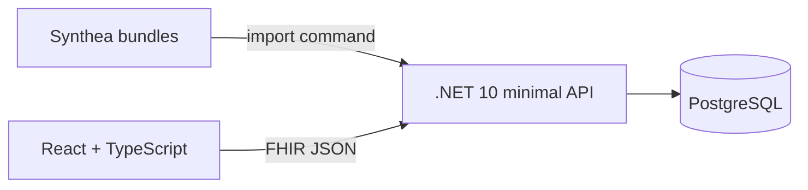

# ChartTrail

[](https://github.com/sudha-bhavi/charttrail/actions/workflows/ci.yml)

A FHIR R4 patient timeline and search API. It imports synthetic [Synthea](https://synthea.mitre.org/) patient bundles into PostgreSQL, serves a FHIR-style search API, and shows each patient's visits, medications and lab results in a React app.

> All data is synthetic. No real patient data is used.

## Screenshots


## Features

- Importer for Synthea FHIR R4 bundles (Patient, Encounter, MedicationRequest, Observation), safe to run again
- FHIR-style search that returns `searchset` Bundles and `OperationOutcome` errors
- CapabilityStatement at `/metadata`
- Patient search, combined timeline and lab trend chart, with light and dark themes

## Architecture



**Stack:** .NET 10, Firely `Hl7.Fhir.R4`, Npgsql, PostgreSQL 17, React, TypeScript, Vite, Recharts, xUnit, Testcontainers, Vitest, GitHub Actions.

## API

| Request                  | Parameters                                                         |
| ------------------------ | ------------------------------------------------------------------ |
| `GET /metadata`          |                                                                    |
| `GET /Patient`           | `name` (prefix of family or given name), `_count`                  |
| `GET /Patient/{id}`      |                                                                    |
| `GET /Observation`       | `patient`, `code`, `category`, `_sort` (`date`, `-date`), `_count` |
| `GET /Encounter`         | `patient`, `_sort`, `_count`                                       |
| `GET /MedicationRequest` | `patient`, `_sort`, `_count`                                       |
| `GET /health`            |                                                                    |

```bash
curl "http://localhost:5200/Patient?name=abd&_count=5"
```

## Run it locally

You need the .NET 10 SDK, Node.js 24 and Docker.

1. Create your local settings and set your own password and port in `.env`:

   ```bash
   cp .env.example .env
   ```

2. Start PostgreSQL:

   ```bash
   docker compose up -d
   ```

3. Give the API the same port and password:

   ```bash
   dotnet user-secrets set "ConnectionStrings:Default" 'Host=localhost;Port=<port>;Database=charttrail;Username=charttrail;Password=<password>' --project src/ChartTrail.Api
   ```

4. Download the FHIR R4 sample data from [Synthea](https://synthea.mitre.org/downloads), unzip it, and import it:

   ```bash
   dotnet run --project src/ChartTrail.Api -- import <folder-with-bundles>
   ```

5. Start the API:

   ```bash
   dotnet run --project src/ChartTrail.Api --urls http://localhost:5200
   ```

6. In a second terminal, start the web app and open http://localhost:5173:

   ```bash
   cd web && npm install && npm run dev
   ```

## Tests

```bash
dotnet test
```

```bash
cd web && npm test
```

The .NET integration tests run the real API against a throwaway PostgreSQL container, so Docker must be running.

## Design decisions

- **Columns plus `jsonb`.** Searchable fields have their own indexed columns, and the full FHIR resource is stored as `jsonb`, so nothing is lost.
- **Plain SQL.** The schema is one SQL file applied by a `migrate` command. The queries are few and explicit.
- **Idempotent import.** Each patient is written in one transaction with upserts, so a failed run can simply be repeated.
- **Firely instead of custom models.** FHIR resources are parsed and serialized with the standard .NET FHIR SDK.
- **Real database in tests.** Testcontainers catches SQL and JSON problems that an in-memory fake would hide.
- **Stale responses ignored.** Quick clicks between patients never show the wrong patient's data.

## Limitations

This is a portfolio project, not a certified FHIR server. It covers a small subset of the specification, is read-only, has no authentication or paging links, and must not be used with real patient data.

## License

[MIT](LICENSE)
